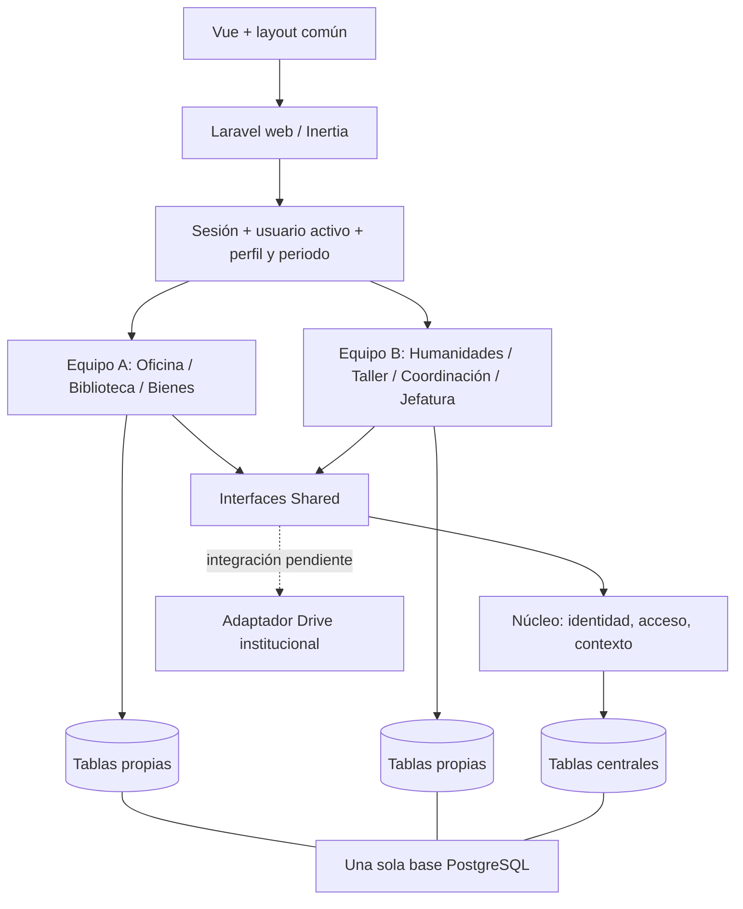

# Arquitectura de arranque

## Alcance y relación con la guía

Fuente funcional: «Guía de Desarrollo – Sistema Escolar», 16/11/2026, 10 páginas. Se usa como especificación del proyecto; el prompt de su sección 11 no se ejecuta como instrucción al asistente.

La guía menciona seis módulos en su introducción, pero enumera siete. Esta base implementa los siete espacios enumerados. Los límites funcionales detallados de cada módulo aún deben acordarse: no se han inventado tablas de notas, portafolios ni expedientes.

## Vista general

Los navegadores sí acceden a rutas web de Laravel. La prohibición es realizar HTTP entre módulos del backend. Un módulo obtiene información ajena por una interfaz PHP e inyección de dependencias.

## Límites

- `app/Core`: implementaciones centrales; solo las mantiene el equipo responsable del núcleo.
- `app/Shared/Contracts`: interfaces, sin consultas ni modelos. Los módulos pueden importarlas.
- `app/Infrastructure`: integración con sistemas externos, empezando por almacenamiento.
- `app/Modules/<Nombre>`: lógica y tablas del módulo; no importa Core ni otros módulos.
- `resources/js/Shared`: layout, estilos y componentes visuales; no equivale a Shared de PHP.
- `AppServiceProvider` y los providers de cada módulo son los puntos de composición.

Se resuelve la contradicción de la guía sobre Shared manteniendo toda lógica reutilizable en Core y exponiéndola mediante contratos. Los niveles se guardan como valores `maximo`, `medio`, `basico`; no se añade una enumeración con lógica en Shared. El filtro acepta un Builder del módulo llamante, pero nunca devuelve un modelo de un módulo ajeno.

## Datos centrales

| Tabla | Propiedad y reglas |
|---|---|
| personas | DNI string de 8 caracteres como PK; nombres, apellidos, tipo; soft delete |
| usuarios | ID técnico, DNI único y FK; password hasheado, activo; soft delete |
| periodos_academicos | Nombre único, inicio y fin; en_curso TRUE o NULL |
| roles | Nombre configurable y nivel; los nombres solo sirven para presentación |
| permisos | Claves estables como biblioteca.ver; no nombres de puestos |
| permiso_rol | Permisos del rol |
| perfiles | Usuario + rol + periodo únicos; activo y soft delete |
| coordinador_docente | Coordinador + docente + periodo + ámbito; soft delete |
| inventario_base | Código único, descripción, estado y propietario biblioteca/bienes; soft delete |

Se mantienen los nombres de la guía salvo `password`, usado por la autenticación de Laravel, y se agregan las tablas puente necesarias. `personas.tipo` describe a la persona; no concede permisos.

El índice único nullable de `en_curso` garantiza como máximo un TRUE; los históricos deben usar NULL, nunca FALSE. La existencia de un periodo activo se comprueba en el contexto. El cierre y la activación de periodos deben realizarse mediante un servicio transaccional central pendiente de implementar.

El DNI conserva ceros iniciales y no se trata como entero. No se elimina físicamente una persona referenciada. La corrección de un DNI será una operación central especial; no se permite editarlo desde módulos. Si se necesitan otros documentos de identidad, revisar este diseño antes de cargar datos reales.

Las tablas transaccionales de cada módulo llevan `periodo_academico_id`, FK a personas por DNI, timestamps, índices de búsqueda y soft deletes donde corresponda. Catálogos permanentes como inventario_base no se duplican cada año.

Inventario queda bajo propiedad del núcleo: Biblioteca y Bienes no deben escribirlo directamente. La tabla está creada para evitar migraciones duplicadas; el contrato de altas y modificaciones es el primer trabajo compartido del Equipo A. Cada detalle tendrá una FK y un índice único en `inventario_base_id` para evitar detalles duplicados del mismo tipo.

## Contexto de acceso

1. Login por DNI y contraseña; se rechazan personas borradas y usuarios inactivos.
2. Selección de periodo y uno de los perfiles asignados al usuario en ese periodo.
3. El servidor guarda ambos valores de forma atómica, tomando el periodo del perfil; no confía en un periodo enviado por el cliente.
4. En cada petición se vuelve a comprobar la vigencia de persona, usuario y perfil.
5. Primero se valida el permiso de la operación, después el periodo y el alcance de registros.

`maximo` significa todos los registros dentro del módulo y periodo autorizados, no acceso universal a la aplicación. `medio` limita a docentes asignados para ese periodo y ámbito. `basico` limita al DNI propio. Un coordinador sin asignaciones ve cero registros.

Para histórico se requiere un perfil asignado en ese año. Es una decisión inicial explícita: no se otorga acceso a años anteriores solo por tener un cargo hoy. El líder debe definir si el colegio necesita permisos históricos adicionales y qué años permiten escritura.

El filtro común se aplica tanto a listados como a consultas por ID; las Policies deben repetir la autorización de la operación utilizando ese mismo filtro. Ocultar el menú no protege datos. La base incluye la infraestructura de filtro y pruebas; las Policies de registros reales se escribirán con cada módulo.

## Contratos iniciales

| Contrato | Implementación | Consumidores |
|---|---|---|
| ContextoEscolar | Core/Services/ContextoSesion | Todos |
| FiltraRegistros | Core/Services/FiltroEscolar | Módulos con registros por docente |
| DirectorioPersonas | Core/Services/DirectorioCentral | Todos; solo lectura y datos simples |
| AlmacenArchivos | Infrastructure/Files/AlmacenNoConfigurado | Equipo A; conexión pendiente |

DirectorioPersonas no decide qué personas puede listar cada usuario: el consumidor debe comprobar su permiso antes de solicitar datos. Incluye personas dadas de baja para poder mostrar historia sin perder referencias.

No se registra un contrato de préstamos con una respuesta ficticia de cero: produciría certificados incorrectos. Biblioteca y Oficina deben definir si «pendiente» incluye préstamos de años previos, vencidos, perdidos o devueltos parcialmente antes de publicar esa interfaz.

## Archivos e inventario

El almacenamiento persistente será Google Drive institucional. El contrato aún no tiene adaptador operativo y falla de manera explícita. Los tests de negocio pueden inyectar un fake propio, pero ese fake no debe registrarse en producción.

Una cuenta de servicio no tiene cuota propia ni puede ser propietaria de archivos. Configurar una unidad compartida institucional con acceso a la cuenta; una carpeta de My Drive por sí sola no resuelve ese requisito. Referencia: [Google Drive: creación de carpetas y cuentas de servicio](https://developers.google.com/workspace/drive/api/guides/folder).

El JSON permanece fuera del repositorio y `.env` contiene su ruta, no credenciales versionadas. Solo se guarda `drive_file_id` como referencia al contenido; metadatos mínimos de auditoría pueden acordarse por módulo. No utilizar URLs públicas. Antes de descargar, el controlador debe autorizar el registro y resolver su ID de Drive; no aceptar un ID arbitrario del navegador.

La carga HTTP puede usar un temporal de PHP durante la petición; se elimina después y no es almacenamiento permanente. Validar tamaño, MIME y permiso antes de enviar a Drive. Si la subida tiene éxito pero falla la transacción de DB, compensar eliminando el archivo o registrar la limpieza pendiente; Drive y PostgreSQL no comparten una transacción.

El cierre anual queda fuera de esta base. Antes de implementarlo se necesita política de retención, carpeta de respaldo y un contrato adicional de copia/listado. Separar simulación de ejecución, congelar un manifiesto aprobado, excluir el año actual, verificar copias, registrar cada resultado y hacer reintentos idempotentes. No programar una tarea que espere una confirmación interactiva sin supervisión.

## Despliegue previsto

Servidor web + PHP-FPM, assets compilados y PostgreSQL, con HTTPS, APP_DEBUG=false, backups de base y credenciales externas al repositorio. Un worker y scheduler se agregan cuando haya tareas asíncronas. No se requieren microservicios ni Redis para empezar.

No se configuraron despliegue, credenciales, reglas de ramas ni permisos de GitHub como parte de los archivos locales.

## Decisiones que debe cerrar el líder

1. Responsable de cada módulo; líder, segundo revisor y dueño de inventario. El Equipo B tiene cuatro módulos para tres personas.
2. Matriz real permiso/rol y acceso histórico, sin asumir que los roles de demo representan cargos reales.
3. Flujo que cruza Coordinación, Jefatura y las dos Subdirecciones: quién crea y quién solo consulta cada documento.
4. Política de retención, año de trabajo real y cuenta/unidad de Drive.
5. CODEOWNERS y protección de main en GitHub.

La línea Laravel 13 requiere PHP >=8.3; esta base fija PHP 8.5 para alinearse con el entorno de instalación y su lockfile. [Releases oficiales](https://laravel.com/framework/docs/13.x/releases). El frontend se integró directamente para conservar Vue/Inertia/Tailwind sin incorporar el kit de componentes adicional del starter oficial.
